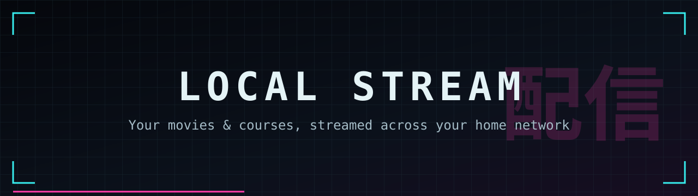
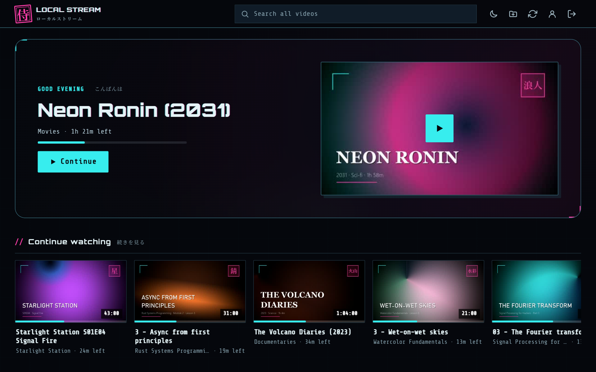
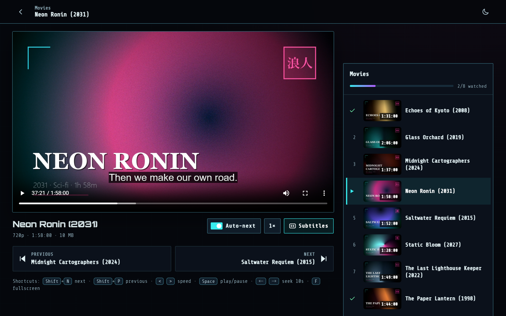
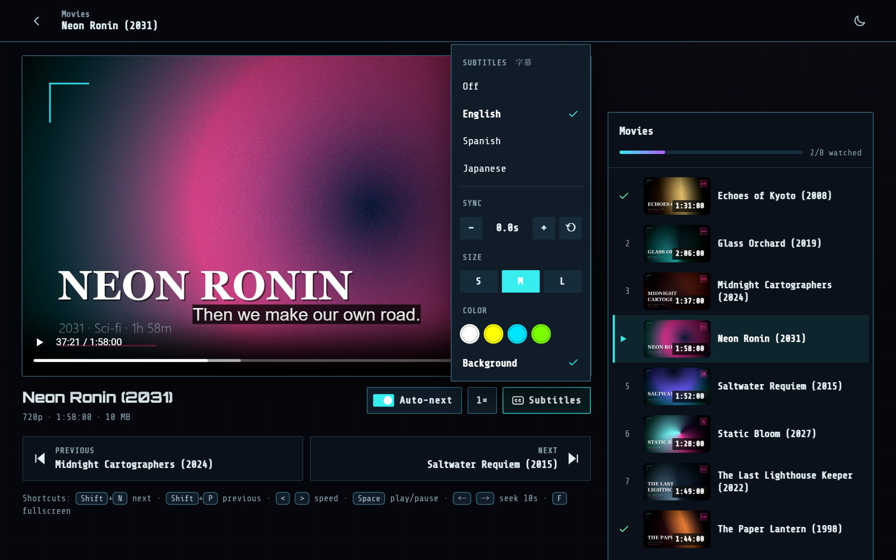
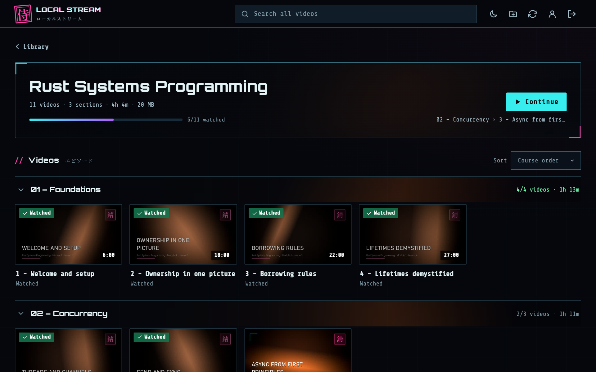
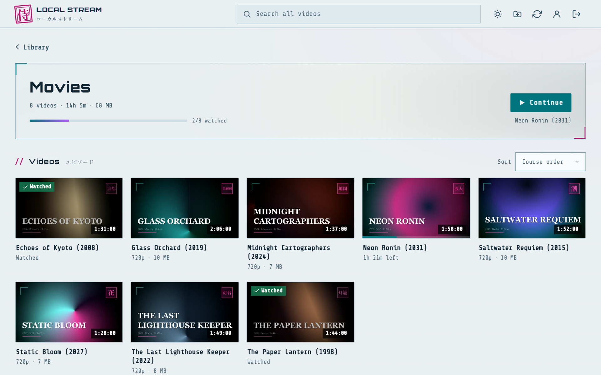
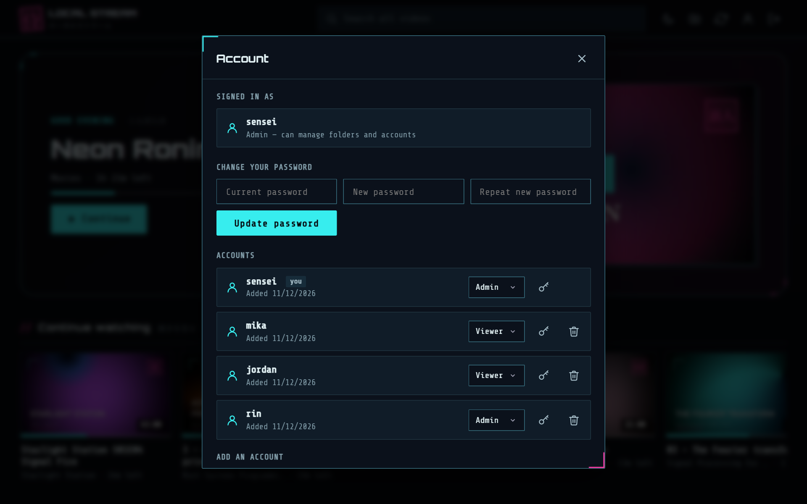
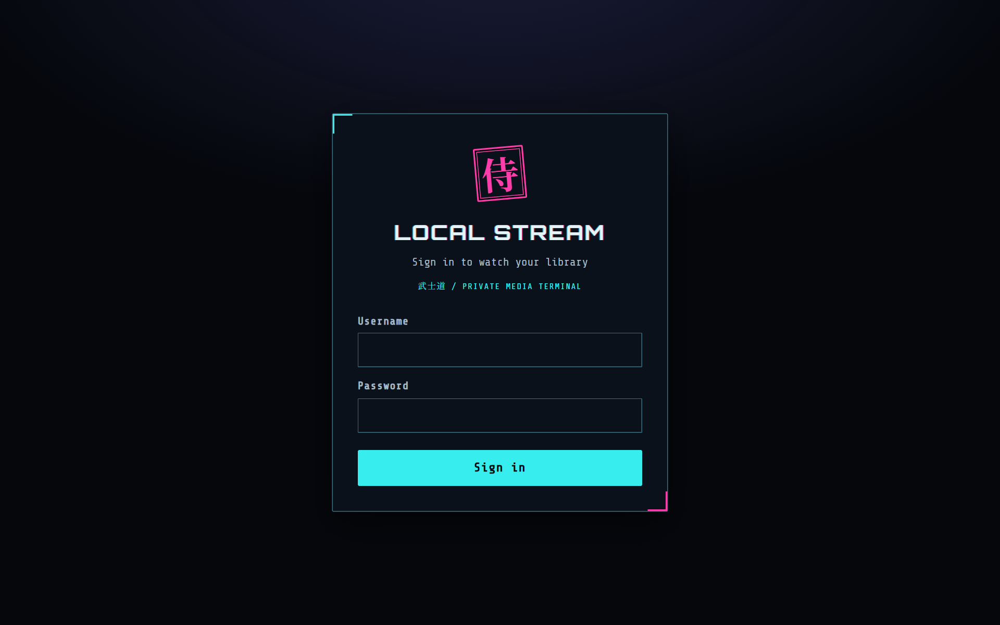
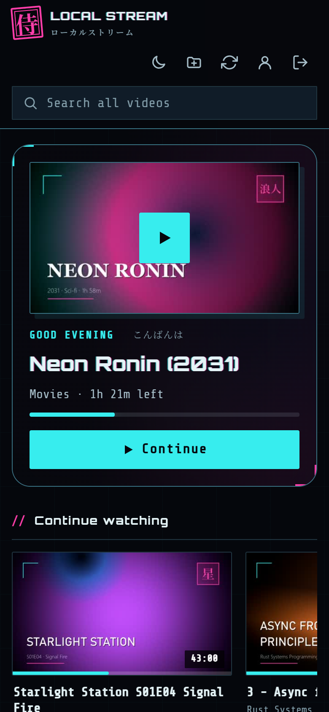
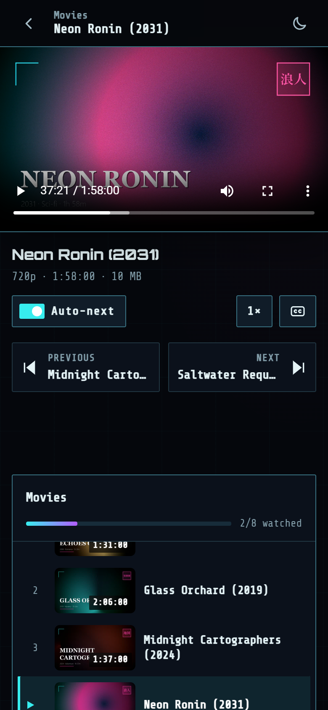

<div align="center">



# Local Stream

**A lightweight, self-hosted video server for your home network.**
Run it on your PC, open a browser on your phone, TV or laptop — and watch.
No app to install, no cloud, no telemetry.


[](LICENSE)

[Features](#-features) ·
[Screenshots](#-screenshots) ·
[Quick start](#-quick-start) ·
[Configuration](#%EF%B8%8F-configuration) ·
[Casting](#-casting-to-tv) ·
[Security](#-security)

</div>

---

## ✨ Features

<table>
<tr>
<td width="50%" valign="top">

### 🎬 Library
- Collections home with a **continue-watching** hero
- Each media folder is a **category**; subfolders become sections
- Release names cleaned up — `Dark.City.1998.1080p.BluRay.x265` → **Dark City (1998)**
- Natural sort (`2 - Intro` before `10 - Advanced`) — great for courses
- Search, sort by name / date / duration / size
- Thumbnails & metadata via FFmpeg

</td>
<td width="50%" valign="top">

### ▶️ Playback
- **Direct play** with instant seeking for MP4 / WebM
- **On-the-fly HLS transcoding** for MKV, AVI, HEVC, Dolby audio…
  (only the incompatible streams are re-encoded)
- **Resume** where you left off, per account
- Playlist sidebar, next-episode, playback speed
- Detects MPEG-TS files hiding behind a `.mp4` extension

</td>
</tr>
<tr>
<td valign="top">

### 💬 Subtitles
- Sidecar (`Movie.en.srt`) **and** `Subs/` folder detection
- `.srt .vtt .ass .ssa .sub` → WebVTT on the fly
- Live **sync offset**, size, colour and background controls
- Language detection from ISO codes and names

</td>
<td valign="top">

### 📺 Cast & share
- **Google Cast** to Chromecast / Google TV, subtitles included
- Works from any phone browser on your Wi-Fi
- Local certificate authority for warning-free **HTTPS**
- **Multi-user accounts** — admins and viewers, separate progress
- **Samurai** skin — cyberpunk HUD frames + hanko-seal kanji, light / dark toggle

</td>
</tr>
</table>

---

## 📸 Screenshots

<p align="center">
  
  <br><sub><b>Library</b> — pick up where you left off, across every collection</sub>
</p>

<table>
<tr>
<td width="50%"><p align="center"><b>Player</b> — resume, subtitles, playlist, next episode</p></td>
<td width="50%"><p align="center"><b>Subtitles</b> — track, sync offset, size, colour</p></td>
</tr>
<tr>
<td><p align="center"><b>Courses</b> — modules in natural order, watched marks</p></td>
<td><p align="center"><b>Light mode</b> — clean release titles, 720p badges</p></td>
</tr>
<tr>
<td><p align="center"><b>Accounts</b> — admins and viewers, own progress each</p></td>
<td><p align="center"><b>Sign in</b> — brute-force protected sessions</p></td>
</tr>
</table>

<p align="center">
  
  &nbsp;&nbsp;
  
  <br><sub><b>On your phone</b> — just open the address in a browser, no app needed</sub>
</p>

> Screenshots use the bundled [demo library](#-try-the-demo) — every title is fictional.

---

## 🚀 Quick start

**Requirements:** [Node.js 18+](https://nodejs.org). [FFmpeg](https://ffmpeg.org) is optional but recommended.

```bash
git clone https://github.com/<your-username>/local-stream.git
cd local-stream
npm install
cp config.example.json config.json   # then edit paths + login
npm start
```

On startup the server prints two addresses:

```
  Local Stream is running!

  Local:   https://localhost:3000
  Network: https://<your-lan-ip>:3000     ← open this on your phone
```

Sign in with the `auth` login from `config.json` — it becomes the first **admin** account.

> [!TIP]
> On Windows you can also double-click **`scripts/start.ps1`** (installs dependencies on first run), or point a
> "run at login" scheduled task at **`scripts/launch-hidden.vbs`** to run it in the background.

### 🎮 Try the demo

Don't want to point it at your own folders yet? Generate a fictional library — 45 title-card videos across
movies, a series, three courses and documentaries, with subtitles — and run an isolated demo server:

```bash
npm run demo:media        # needs FFmpeg; ~170 MB in demo/media/, a few minutes
npm run demo              # http://localhost:4321 — sign in as sensei / demo-only-password
```

The demo uses its own config, data folder and port, so it never touches your real `config.json` or accounts.
`npm run demo:screenshots` regenerates the images in this README (seeds accounts and watch history, then captures
with headless Edge or Chrome — override with `BROWSER=/path/to/chrome`).

### Install FFmpeg (recommended)

FFmpeg unlocks thumbnails, metadata, subtitle conversion and transcoding of non-MP4 files.

| OS | Command |
|---|---|
| Windows | `winget install ffmpeg` |
| macOS | `brew install ffmpeg` |
| Debian / Ubuntu | `sudo apt install ffmpeg` |

Restart the server afterwards (open a new terminal so the updated `PATH` is picked up).

### Open the firewall (Windows, one time)

Windows blocks incoming connections by default. In an **elevated** PowerShell:

```powershell
powershell -ExecutionPolicy Bypass -File scripts\setup-firewall.ps1
```

It reads your ports from `config.json` and allows them on the **Private** network profile only — never on public Wi-Fi.
Add `-WhatIf` to preview. To undo: `Remove-NetFirewallRule -DisplayName "Local Stream*"`.

---

## ⚙️ Configuration

Copy [`config.example.json`](config.example.json) to `config.json` (git-ignored) and adjust:

```jsonc
{
  "port": 3000,
  "castHttpPort": 3001,
  "https": { "enabled": true },
  "mediaDirs": [
    { "path": "C:\\Videos\\Movies", "category": "Movies" },
    { "path": "D:\\Courses",        "category": "Courses" }
  ],
  "allowedHosts": [],
  "auth": { "username": "admin", "password": "change-me-to-a-long-passphrase" }
}
```

| Key | Default | Description |
|---|---|---|
| `port` | `3000` | Main web port |
| `https.enabled` | `true` | Serve over HTTPS with a locally generated CA (required for in-page casting) |
| `castHttpPort` | `3001` | Plain-HTTP, token-protected port the Chromecast pulls media from. `null` disables casting |
| `mediaDirs` | `["./media"]` | Folders to scan. A plain string works too; its category defaults to the folder name |
| `allowedHosts` | `[]` | Extra hostnames you reach the server by (IP addresses, `localhost` and this PC's name are always allowed) |
| `auth` | — | Bootstrap login for the **first** admin. Ignored once accounts exist — delete it afterwards |
| `thumbnailWidth` | `480` | Thumbnail width in pixels |
| `transcodePreset` | `veryfast` | x264 preset — faster uses less CPU but makes larger files |
| `hlsSegmentDuration` | `4` | HLS segment length in seconds |

`STREAM_USER` / `STREAM_PASSWORD` environment variables override the `auth` block, and `LS_CONFIG=/path/to/config.json`
loads a different config file (that's how the demo stays isolated).

### Managing media from the UI

Admins can click the **folder** icon to browse the server's drives, add a folder as a new category, rename or remove one.
Changes are saved to `config.json` and the library rescans immediately — no restart needed.

**Supported video:** `.mp4 .mkv .avi .mov .wmv .flv .webm .m4v .ts`

---

## 💬 Subtitles

```text
Movie.mp4
Movie.srt              →  sidecar, labelled "Subtitles"
Movie.en.srt           →  sidecar, labelled "English"
Subs/English.srt       →  subfolder, labelled "English"
Subs/spa.srt           →  subfolder, labelled "Spanish"
```

The player's **CC** button lets you pick a track, nudge **sync** in ±0.5 s steps, and change size, colour and background.
Preferences are remembered and carried over to the TV when casting.

> [!NOTE]
> Image-based embedded subtitles (e.g. PGS in Blu-ray rips) can't be turned into text and won't be listed.

---

## 📺 Casting to TV

Open a video and tap **Cast** to send it to a Chromecast / Google TV / Android TV on your network.

<details>
<summary><b>How it works</b></summary>

- The Cast button needs a **secure context**, which is why HTTPS is on by default.
- A Chromecast won't trust a private certificate, so the TV fetches media and subtitles from the plain-HTTP
  **`castHttpPort`**. That port serves *only* media and subtitle files, and only with a random **cast token**
  that is regenerated on every server start and handed only to signed-in users.
- Files the TV can't play raw (HEVC, E-AC-3 / AC-3 audio, MKV…) are cast as the **transcoded HLS stream**,
  with the token injected into each segment URL.
- Transcoding starts from the beginning of the file, so casting an incompatible file starts at 0.

</details>

<details>
<summary><b>Trusting the local certificate (no more "Not secure")</b></summary>

On first run the server creates a small certificate authority in `data/certs/` and signs its HTTPS certificate
with it (valid for `localhost`, `127.0.0.1` and your LAN IP). Install the CA once per device — the warning
disappears and browsers will offer to save your password. Download it from **`/ca.pem`**:

- **Android:** Settings → Security → *Encryption & credentials* → *Install a certificate* → *CA certificate*
- **iPhone / iPad:** open the link in Safari → install the profile under *VPN & Device Management* → enable it in
  *About → Certificate Trust Settings*
- **Windows / macOS:** import into the Trusted Root store

The CA private key (`data/certs/ca-key.pem`) never leaves the machine. Delete `data/certs/` to regenerate everything.

</details>

---

## 👥 Accounts

- **Admins** add accounts, switch roles, reset passwords, delete accounts, and manage media folders.
- **Viewers** browse and watch. The server refuses admin actions from viewers — it isn't just hidden in the UI.
- Everyone can change their own password; other devices are then signed out.
- Each account has its **own watch progress**.
- There's always at least one admin, and no public sign-up.

With **no accounts at all**, the library is open on your LAN, but only **this PC** (`localhost`) may create the first
admin or manage folders — nobody else on the network can claim the server.

---

## 🔒 Security

Local Stream is built for a **trusted home network**. Don't expose it to the internet as-is.

| Protection | Details |
|---|---|
| Passwords | Salted **scrypt** hashes; constant-time comparison; unknown usernames take as long as wrong passwords |
| Sessions | Random 256-bit tokens in an `HttpOnly`, `SameSite=Lax` cookie (`Secure` under HTTPS), 30-day expiry |
| Brute force | 10 failed sign-ins per IP → locked out for 15 minutes (`429` + `Retry-After`) |
| DNS rebinding | Requests for unknown hostnames are rejected (`421`); see `allowedHosts` |
| CSRF | State-changing requests with a foreign `Origin` are refused; CORS only on read-only media routes |
| Cast port | Serves only media / subtitle files and only with the per-start token — no login page over plain HTTP |
| Path traversal | Media is served by library ID only; HLS file names and IDs are allow-listed |
| Headers | `nosniff`, `X-Frame-Options: DENY`, `frame-ancestors 'none'`, `Referrer-Policy: same-origin`; no stack traces |
| XSS | All file and folder names are HTML-escaped before rendering |

> [!IMPORTANT]
> Use a **long, unique password** for the admin account, keep **HTTPS on** (otherwise logins cross your Wi-Fi
> in plain text), and remove the `auth` block from `config.json` once the first admin exists.

Found a vulnerability? Please open a private security advisory rather than a public issue.

---

## 🗂️ Project layout

```text
local-stream/
├── src/
│   ├── server.js        Express app, API and streaming routes
│   ├── security.js      Rate limiting, Host/Origin checks, security headers
│   ├── auth.js          Sessions and cookies
│   ├── users.js         Accounts, password hashing, per-account progress
│   ├── scanner.js       Library scan, ffprobe metadata, thumbnails
│   ├── transcoder.js    Direct streaming and HLS transcoding
│   ├── subtitles.js     Subtitle discovery and WebVTT conversion
│   ├── certs.js         Local CA and HTTPS certificate
│   └── config.js        Config loader and defaults
├── public/              Web UI (pages, JS, themes)
├── scripts/             start.ps1, launch-hidden.vbs, setup-firewall.ps1
├── demo/                Demo library generator, demo server, screenshot capture
├── docs/screenshots/    README images
├── media/               Default media folder (your videos go here)
├── data/                Runtime state — created on first run, git-ignored
└── config.example.json  Copy to config.json
```

<details>
<summary><b>What lives in <code>data/</code></b></summary>

| Path | Contents |
|---|---|
| `users.json` | Accounts (scrypt hashes) |
| `sessions.json` | Active sessions — delete to sign everyone out |
| `progress/<id>.json` | Per-account watch progress |
| `thumbnails/` | Generated thumbnails |
| `subtitles/` | Cached WebVTT conversions |
| `transcode/` | HLS segments — cleared on every restart |
| `certs/` | Local CA and server certificate (**contains private keys**) |

</details>

---

## 🛠️ Troubleshooting

<details>
<summary><b>My phone can't connect</b></summary>

- Make sure the phone is on the **same Wi-Fi** as the PC.
- Run `scripts/setup-firewall.ps1` (Windows) and check your network is set to **Private**.
- The printed *Network* address skips VMware / VirtualBox / WSL adapters. If it still looks wrong, check
  `ipconfig` for your real Wi-Fi / Ethernet adapter.

</details>

<details>
<summary><b>A video plays without sound</b></summary>

Usually Dolby (E-AC-3 / AC-3) audio, which browsers can't decode. Install FFmpeg — the server then transcodes just
the audio track.

</details>

<details>
<summary><b>"Unknown host name" (421)</b></summary>

You're reaching the server by a hostname it doesn't recognise. Add it to `"allowedHosts"` in `config.json`.

</details>

<details>
<summary><b>"Too many failed sign-ins" (429)</b></summary>

Wait 15 minutes, or restart the server to clear the lockout.

</details>

---

## 📄 License

Released under the [MIT License](LICENSE).

<div align="center">
<sub>Made for movie nights and late-night course binges · 配信</sub>
</div>
